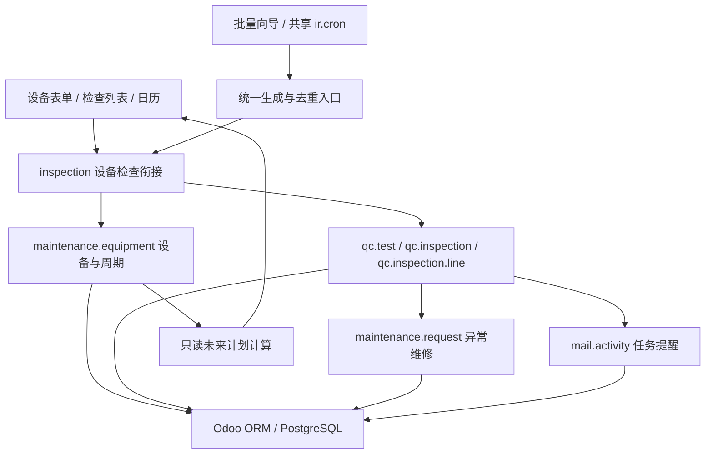

# 架构与复用边界

## 模型职责

| 部分 | 上游能力 | 本项目扩展 |
| --- | --- | --- |
| Maintenance | 设备、类别、团队、维修请求、维修阶段 | 默认方案、检查主管、周期参数、摘要、来源检查 |
| OCA Quality Control | 方案、检查项目、答案、执行单及结果行 | 设备关联、必答校验、当次标准与单位快照、结果冻结、生成入口 |
| Mail | 消息、活动、负责人、截止日期 | 检查与活动的最小关联及状态同步 |
| Web Calendar | 原生日历、详情与表单交互 | 可见范围内合并只读未来计划，不创建镜像事件表 |
| 批量操作 | Odoo TransientModel | `inspection.generate` 向导，共用生成方法 |

一台设备有一个默认检查方案和一套周期配置。一个方案可有多个检查项目，每次检查生成自己的结果行。已完成检查保留当次标准，不跟随方案修改。异常确认后才能转维修，一张检查至多关联一张维修请求；维修完成不会改写检查的历史异常结论。

周期由锚点 + 间隔 + 日/周/月单位组成，使用 `dateutil.relativedelta`。关闭/恢复通过一个界面开关操作，保留计划进度。后台只补最近一期，设备行锁与条件唯一索引防重。日期规则与后台唤醒间隔是两回事。

## 公开重置边界

访客入口是独立的小型 HTTP 服务，不持有 Docker socket 或数据库密码。它只允许执行一个 root 管理、无参数的固定重置脚本。脚本固定操作独立 Compose 项目及 `inspection_template/inspection_next/inspection_demo/inspection_previous` 四个库名。

先克隆空业务模板，加载当天 demo 并校验数量，再短暂停机切换数据库和 filestore。保留上一套数据用于失败恢复。该流程不读取或发布本地学习数据库。
